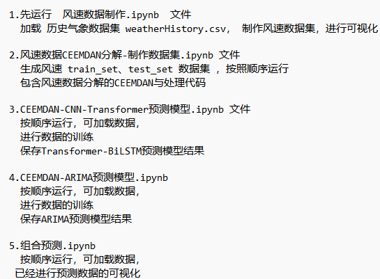
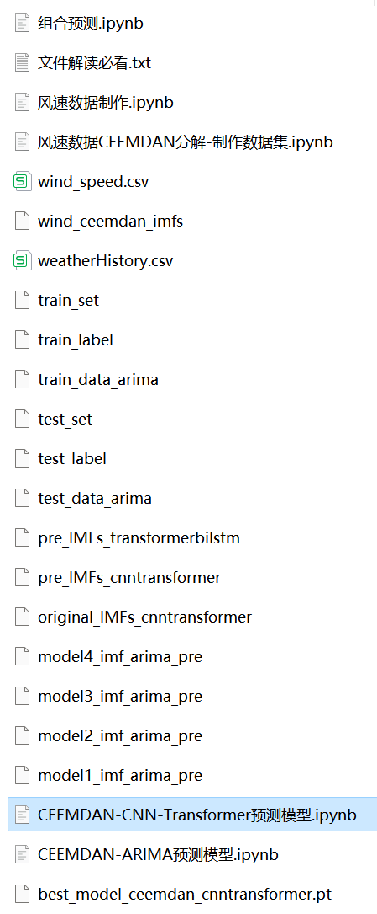

# CEEMDAN+(CNN-Transformer+ARIMA) Combination Forecasting Model

The method of Comprehensive Ensemble Experience Mode Decomposition (CEEMDAN) and hybrid predictive models (CNN-Transformer + ARIMA) is proposed to enhance the prediction performance of time series data. The core of this method lies in the use of CEEMDAN algorithm for decomposition of time series, followed by modeling of the decomposed data using CNN-Transformer and ARIMA models, and finally, the integration of both models' predictive results.
Include wind speed data, as well as the wind speed dataset and label set that have been generated and processed through CEEMDAN decomposition. The corresponding codes can be run, and there are also examples of CEEMDAN decomposition.
CNN-Transformer + ARIMA model, with smaller MSE and MAE, showing particularly significant results.
Includes code for data preprocessing with CEEMDAN, complete CNN-Transformer model prediction code, ARIMA prediction model code, and visualization code.
Environment: Python 3.9
\n        \n  
\n        \n  

## Images

<!-- PAYMENT_BLOCK -->

## Get this dataset

- Payment link (Stripe): [Buy now](https://buy.stripe.com/3cs8yP7sY87d0vu9AB)
- Payment QR code: 

<!-- /PAYMENT_BLOCK -->
